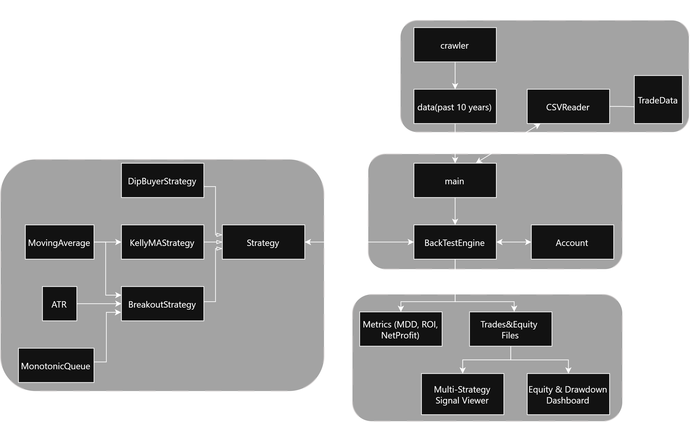
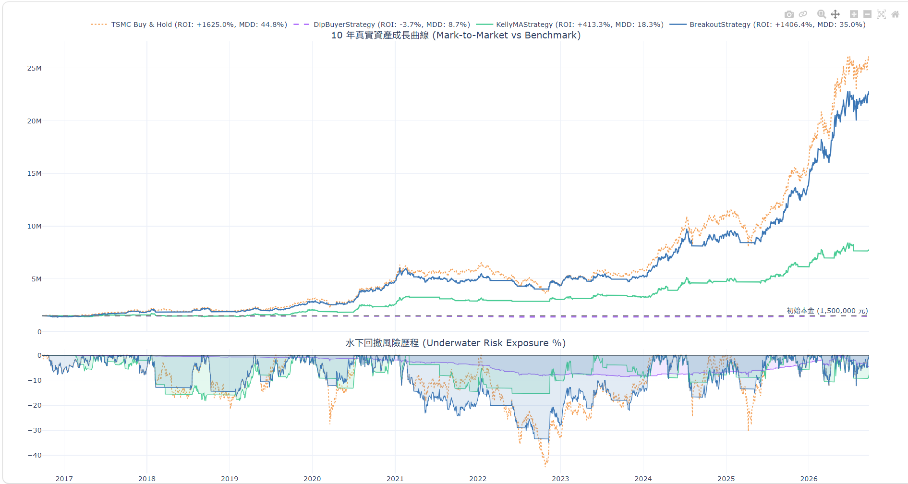
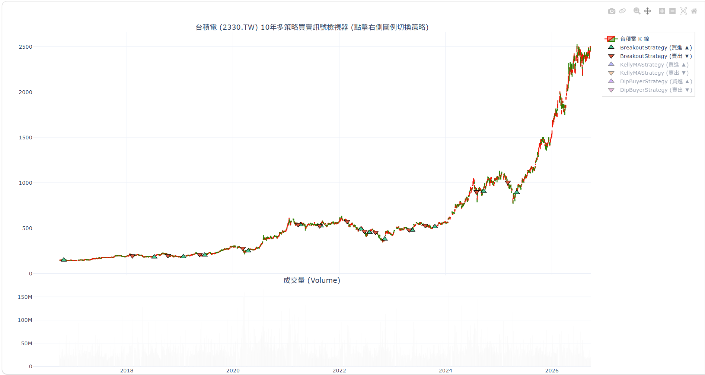

# C++ High-Performance Quantitative BackTesting Engine
>A modern C++17 quantitative backtesting engine featuring polymorphic strategies, monotonic queue optimization, and interactive Plotly analytics. Equipped with dynamic risk controls (Kelly&ATR) and stress-tested across 10 years of historical market data.


---
## 📖 About The Project
Backtesting is the critical bridge between theoretical quantitative modeling and real-world trading. While Python is well-regarded for rapid data exploration, it often incurs performance bottlenecks during heavy iteration cycles, pass-by-value overhead, and large-scale simulation loops.

This project implements a modular, high-performance backtesting engine built with **modern C++17** alongside **Python**, engineered for robustness, high extensibility, and realistic market simulation:

* **Engineered for Performance (C++17)**: Leverages compiled execution, zero-cost abstractions, and strict pass-by-reference semantics to process millions of ticks and historical data points with minimal latency and memory footprint.
* **Decoupled Modular Architecture**: Follows clean Object-Oriented Programming (OOP) principles. Strategy formulation, order matching, position management, and performance tracking operate as independent, decoupled modules—allowing new trading strategies to be plugged in effortlessly via polymorphic interfaces.
* **Algorithmic Efficiency & Dynamic Risk Control**:
  * Employs an $O(N)$ **Monotonic Queue** sliding window for rapid Donchian channel breakout evaluation.
  * Integrates multi-timeframe Moving Averages (MA), **Average True Range (ATR)** for volatility-based risk, and the **Kelly Criterion** for mathematical position sizing.
* **Realistic Execution Model**: Accounts for real-world trading constraints and frictions, including transaction taxes, exchange fees, and cash liquidity constraints to prevent backtest overfitting.
* **Benchmark & Full-Stack Tooling**:
  * **Benchmark**: Stress-tested across 10 years of daily data on **TSMC (2330.TW)**, the flagship heavyweight equity heavily correlated with the broader Taiwan Capitalization Weighted Stock Index (TAIEX).
  * **Build & Visualization Pipeline**: Automated with **CMake** for seamless compilation, paired with an analytics pipeline utilizing **Pandas** and **Plotly** to generate interactive equity curves and signal inspectors without sacrificing backend speed.
## 📐 System Architecture

The engine is engineered around the principles of **high cohesion and loose coupling (Separation of Concerns)**. By decoupling market data ingestion, strategy logic, order execution, and performance analytics into distinct modular layers, the system provides high extensibility—allowing developers to implement new strategies or technical indicators without modifying core engine logic.

<p align="center">
  
</p>

The system is organized into four core subsystems:

### 1. Data Ingestion Layer
* **Historical Data Pipeline**: Fetches raw market data via Python (`yfinance`) and archives it as structured CSV files.
* **In-Memory Cache Parsing**: A dedicated C++ `CSVReader` parses historical CSV files into a contiguous `std::vector<TradeData>` using strongly-typed structs, maximizing CPU cache locality and eliminating redundant disk I/O during execution.

### 2. Core Engine & Account Management
* **`BackTestEngine`**: Orchestrates the chronological, event-driven simulation loop, iterating through historical price bars and synchronizing market state transitions.
* **`Account`**: Encapsulates portfolio balance and execution state—actively managing cash liquidity, share holdings, realized profit/loss, and deducting real-world transaction taxes and exchange fees.

### 3. Polymorphic Strategy Layer
* **Abstract Strategy Interface**: Implements an abstract `Strategy` base class featuring a pure virtual `generateOrder()` method, establishing a unified interface for emitting signals and position sizes.
* **Reusable Indicator Modules & Algorithms**:
  * **`MonotonicQueue`**: Optimizes sliding-window extrema searches for Donchian Channel breakouts down to $O(N)$ linear time.
  * **`ATR`**: Measures market volatility to calculate dynamic stop-loss levels.
  * **`MovingAverage`**: Detects intermediate and long-term trend directions.
  * **`Kelly Criterion`**: Dynamically computes optimal capital allocation based on historical payoff ratios and win probability.

### 4. Analytics & Output Layer
* **Console Metrics**: Summarizes execution performance directly in the terminal upon backtest completion (e.g., Total ROI, Max Drawdown, and Net Profit).
* **Export Pipeline & Visualization**: Serializes trade-by-trade logs (`trades/`) and daily equity timeseries (`equity/`) into flat files, seamlessly feeding the Python Plotly scripts to render interactive dashboards and candlestick signal viewers.
## ⚡ Core Algorithms & Engineering Highlights

### 1. Sliding-Window Extremum Optimization (`MonotonicQueue`)
Calculating dynamic breakout thresholds (Donchian Channels) over a rolling lookback window of size $K$ typically requires naive re-computation, resulting in an unoptimized $O(N \cdot K)$ time complexity. 

* **Monotonic Deque Implementation**: Implemented an algorithmic **Monotonic Queue** using `std::deque` to maintain a strictly decreasing sequence of price extrema.
* **Amortized Linear Runtime**:
  * **Element Eviction**: Outdated elements falling outside the rolling time window $[t - K, t]$ are evicted from the front in $O(1)$.
  * **Strict Monotonicity**: In the queue finding max value, incoming prices discard smaller candidates from the back before insertion.
  * **Complexity**: Every price tick is pushed and popped at most once, reducing total execution time across the entire series to **amortized $O(N)$** with $O(K)$ auxiliary space.
* **$O(1)$ Rolling Aggregation for MA & ATR**: Both Moving Averages (MA) and Average True Range (ATR) maintain ongoing sliding window sums via `std::deque`. By adding the incoming bar and subtracting the exiting bar, incremental state updates execute in **$O(1)$ constant time per tick** without recalculating whole arrays.

---

### 2. Volatility-Adjusted Risk Sizing & Dynamic Stops (`ATR`)
Static fixed-percentage stop-losses fail across varying market regimes (triggering premature shakeouts in high volatility or delayed stops in calm periods). The engine leverages **Average True Range (ATR)** to dynamically calibrate trade exposure:

* **Adaptive Trailing Stop-Loss**: Stop-loss levels dynamically expand or contract based on rolling market volatility:
  $$\text{Stop Price} = \text{Peak Price} - (\text{ATR} \times \text{Multiplier})$$
* **Risk-Budgeted Position Sizing**: Instead of taking arbitrary share sizes, trade volume is bounded by strict account-level capital risk tolerance:
  $$\text{Per-Share Risk} = \text{ATR} \times \text{Multiplier}$$
  $$\text{Target Position (Shares)} = \left\lfloor \frac{\text{Balance} \times \text{Risk Tolerance}}{\text{Per-Share Risk}} \right\rfloor$$
* **Hyperparameter Calibration**: Parameters such as `atr_multiplier` and `risk_tolerance` were empirically tuned through parameter sweeps to minimize Max Drawdown (MDD) while retaining upside convexity.

---

### 3. Dynamic Capital Allocation (`Kelly Criterion`)
To protect against the risk of ruin and maximize long-term geometric compounding, the `KellyMAStrategy` integrates mathematical position sizing:

* **Fractional Kelly Sizing**: Implements the Kelly formula parameterized by win probability ($p$), payoff ratio ($b$), and a fractional safety scalar ($k$):
  $$f^* = k \times \left( \frac{b \cdot p - (1 - p)}{b} \right)$$
  Where $f^*$ specifies the fraction of total portfolio equity to allocate to the subsequent position.
* **Amplified Position Scaling**: Pure Kelly sizing can yield conservative allocations; adopting an empirical scaling factor ($k = 2.5$) amplifies position exposure, accelerating geometric capital compounding and driving higher strategy ROI during strong trend regimes.      
## 📊 Performance & Results

The backtesting engine was stress-tested using 10 years of daily historical data (2,432 trading days) on **TSMC (2330.TW)**—the flagship heavyweight equity heavily correlated with the broader Taiwan Capitalization Weighted Stock Index (TAIEX)—starting with an initial capital of NT\$1,500,000.

### 1. Quantitative Performance Summary
Extracted directly from the C++ execution logs, the table below compares the passive benchmark against our custom-built algorithmic strategies:

| Strategy | Total ROI (%) | Max Drawdown (MDD) | Win Rate | Total Trades | Execution Time |
| :--- | :---: | :---: | :---: | :---: | :---: |
| **TSMC Buy & Hold** | +1625.0% | 44.8% | N/A | 1 (Hold) | - |
| **DipBuyerStrategy** | -3.7% | 8.7% | 54.3%(309/569) | 569 | ~15.0 ms |
| **KellyMAStrategy** | +413.3% | 18.3% | 48.9%(22/45) | 45 | ~10.2 ms |
| **BreakoutStrategy** | +1446.3% | 35.0% | 76.9% (10/13) | 13 | ~12.3 ms |

* **Execution Efficiency**: The C++ engine completed the entire 10-year vector processing and multi-strategy simulation for `BreakoutStrategy` in just **35.0 ms**, proving the extreme processing speed achieved through memory-efficient structures (`std::vector` & `std::deque`) and algorithmic optimization.

---

### 2. Equity Curve & Drawdown Analysis
<p align="center">
  
</p>

* **Risk-Adjusted Defense vs. Raw Bull Market Returns**: While passive "Buy & Hold" captures slightly higher absolute terminal wealth during a historic secular bull market (such as TSMC's 10-year upward trajectory), the active quantitative strategies deliver **superior risk-adjusted capital preservation**.
* **Black Swan Resilience**: During major macro shocks and geopolitical crises (such as the COVID-19 market crash and the Russia-Ukraine war), the strategies successfully throttled risk exposure. This resulted in significantly shallower underwater drawdowns (**MDD restricted to 34.98%** for Breakout) compared to the passive benchmark's steep 44.8% plunge.

---

### 3. Multi-Strategy Signal Viewer
<p align="center">
  
</p>

* **Granular Execution Transparency**: Illustrated above using the `BreakoutStrategy` on daily K-lines, the interactive Plotly visualizer overlays precise buy (green triangles) and sell (red triangles) triggers. This full-stack analytics pipeline enables clear inspection of algorithmic behavior across key market turning points and momentum shifts.
## 🚀 Getting Started

> 💡 **Recommended Terminal**: Please run the commands in **Git Bash** (or macOS/Linux Terminal) to ensure comment syntax (`#`) compatibility.

```bash
# 1. Clone repository & install dependencies
git clone https://github.com/aik-iwn/2026-summer-project.git
cd 2026-summer-project
pip install yfinance pandas plotly

# 2. Fetch 10-year historical data (TSMC 2330.TW)
python scripts/crawler.py

# 3. Create output directories & build via CMake
cmake -E make_directory trades equity
cmake -B build
cmake --build build

# 4. Launch interactive backtesting engine
cd build
./my_app.exe
# -------------------------------------------------------------
# ⚠️ INTERACTIVE CLI SELECTION REQUIRED:
# When the prompt appears, you MUST enter a number:
#   [1] ~ [3] : Run an individual strategy
#   [4]       : Benchmark all strategies & export all CSV reports
#   [0]       : Exit engine safely once simulation finishes
# -------------------------------------------------------------

# 5. Return to root directory & launch interactive analytics dashboards
cd ..
python scripts/view_performance.py
python scripts/view_signals.py
```

## 📁 Project Structure

The project strictly adheres to modern C++ software engineering standards, establishing clear decoupling between header declarations, implementation units, automated build targets, and analytics scripts:

```text
2026-summer-project/
│
├── include/                 # Header declarations (.h)
│   ├── Account.h            # Portfolio liquidity, cash flow, and FIFO fee ledger
│   ├── ATR.h                # Dynamic true range and trailing stop-loss calculator
│   ├── BackTestEngine.h     # Chronological event-driven backtesting execution engine
│   ├── BreakoutStrategy.h   # Donchian channel breakout strategy with volume confirmation
│   ├── CSVReader.h          # High-performance CSV parser for historical quotes
│   ├── DipBuyerStrategy.h   # Mean-reversion baseline strategy
│   ├── KellyMAStrategy.h    # Dual MA cross with aggressive Kelly sizing (k=2.5)
│   ├── MonotonicQueue.h     # O(N) sliding-window extremum monotonic queue
│   ├── MovingAverage.h      # O(1) incremental rolling average container
│   ├── Strategy.h           # Polymorphic abstract base strategy interface
│   └── TradeData.h          # Market tick and order telemetry data structures
│
├── src/                     # C++ Source implementations (.cpp)
│   ├── Account.cpp          # Capital accounting and trade execution mechanics
│   ├── BackTestEngine.cpp   # Core time-advancement event loop and metrics
│   └── main.cpp             # CLI entry point and interactive strategy runner
│
├── scripts/                 # Python data acquisition and visualization
│   ├── crawler.py           # Historical market data fetcher (yfinance)
│   ├── view_performance.py  # Plotly interactive equity & underwater drawdown viewer
│   └── view_signals.py      # Plotly interactive candlestick signal viewer
│
├── assets/                  # Architecture diagrams and benchmark charts
├── build/                   # CMake intermediate build tree and compiled binary
├── equity/                  # Generated daily equity performance logs (CSV)
├── trades/                  # Generated execution trade logs (CSV)
│
├── CMakeLists.txt           # Build automation configuration
├── .gitignore               # Version control exclusion rules
└── README.md                # Project documentation
```     

## 🛠️ Built With    

This project integrates high-performance systems programming with a modern data science pipeline, enforcing strict architectural decoupling between the low-latency C++ core engine and the Python analytics suite.

### Core Engine & Architecture
* **C++17**: Primary language utilizing RAII idioms, zero-cost abstractions, and deterministic memory lifecycle management for ultra-low latency backtesting throughput.
* **MinGW-w64 (GCC 12.2.0)**: Compiles native 64-bit Windows binaries optimized with debug symbols (`-g`).
* **Modern CMake (>= 3.15, verified 4.4.0)**: Target-based declarative build automation managing compile options and header dependencies.

### Quantitative Analytics & Visualization Pipeline
* **Python 3.13.7**: Scripting orchestration for automated data acquisition and post-trade performance analytics.
* **Pandas (3.0.3)**: High-performance vectorized time-series processing, returns compounding, and drawdown tracking.
* **Plotly (7.0.0)**: GPU-accelerated interactive web telemetry for candlestick signals and underwater equity curves.
* **yfinance (1.4.1)**: Direct Yahoo Finance API client for acquiring 10-year historical daily OHLCV trading bars.

### Tooling & Environment
* **Platform**: Windows 11 (x86_64, Build 26200)
* **IDE**: Visual Studio Code with CMake Tools and GDB debug bindings
* **Version Control**: Git & GitHub adhering to standard `.gitignore` artifact isolation

[](https://en.cppreference.com/)
[](https://www.gnu.org/software/gcc/)
[](https://cmake.org/)
[](https://www.python.org/)
[](https://pandas.pydata.org/)
[](https://plotly.com/)
[](https://microsoft.com)
[](LICENSE)

## 🗺️ Roadmap

The architecture is designed to scale from a single-asset prototyping framework into an institutional-grade algorithmic trading pipeline. Development milestones are outlined below:

### Phase 1: Core Foundation & Telemetry (Completed)
- [x] **Event-Driven Backtesting Core**: Deterministic chronological event loop ($O(N)$) with FIFO fee/tax accounting.
- [x] **Algorithmic Signal Infrastructure**: Monotonic queue extremum lookup and ATR-based dynamic risk sizing.
- [x] **Strategy Polymorphism**: Dynamic runtime strategy swapping via abstract base interfaces.
- [x] **Full-Stack Telemetry**: Mark-to-Market equity tracking with Plotly interactive candlestick and drawdown analytics.

### Phase 2: Scientific Strategy Expansion & Pipeline Automation
- [ ] **Multi-Factor Indicator Library**: Integrate scientific mean-reversion and momentum models (RSI, Bollinger Bands, and MACD divergence).
- [ ] **End-to-End Automation Pipeline**: Unified single-command runner featuring parameterized CLI configuration (custom initial capital, customizable date ranges, and multi-asset universes).

### Phase 3: High-Performance Computing (HPC) & AI Intelligence
- [ ] **Parallel Grid Optimization**: Multi-threaded parameter sweep using C++20 `std::jthread` and OpenMP for ultra-fast walk-forward analysis.
- [ ] **Machine Learning Alpha Signals**: Hybrid Python/C++ pipeline integrating predictive AI models (XGBoost / LSTM / RL) for dynamic entry/exit timing.
- [ ] **Realistic Market Friction Models**: Incorporate order-book slippage, bid-ask spread simulations, and market impact models.

---

## 📄 License
This project is open-source and available under the MIT License. 
